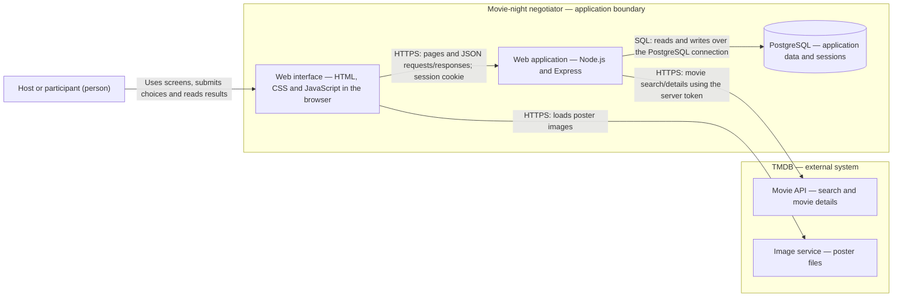

# Movie-night negotiator — container diagram

A container diagram shows the major running parts of an application, their responsibilities and how they communicate. Think of a restaurant: the browser is the customer-facing counter, Express is the kitchen coordinating orders, PostgreSQL is the records room, and TMDB is an outside supplier of movie information.

Status: proposed architecture for the stack in ROADMAP.md. PostgreSQL remains the selected database; discussing MongoDB did not change that decision.

## Diagram

## Responsibilities

| Part | Owns |
|---|---|
| Browser interface | Login forms, nights dashboard, movie search, board, vote selection and results; loading/error feedback. |
| Express application | Serves frontend files and the app API; validates input; authenticates users; checks membership and phase permissions; coordinates nominations, votes, closing and ties; calls TMDB. |
| PostgreSQL | Users, nights, memberships, nominations, votes, saved results and sessions; relationship/uniqueness constraints and transactional writes. |
| TMDB movie API | External search results and movie details. |
| TMDB image service | External poster images, fetched by the browser using their public image URLs. |

Arrows identify communication relationships, not a sequence of events. For example, the browser-to-Express arrow includes the response as well as the request.

## Minimal walkthrough

1. Sam searches for Alien in the browser.
2. The browser asks Express for search results. Express queries TMDB using its server-side credential and returns movie information.
3. Sam selects and confirms a movie. Express checks Sam's membership and the current phase, obtains trusted movie details and saves the nomination in PostgreSQL.
4. The browser renders the saved title/details and loads the poster from TMDB's image service.
5. When Sam votes, Express checks the rules and writes the vote to PostgreSQL. TMDB is not involved in counting votes or deciding the winner.

## Important boundaries

- The browser has no database connection and receives neither database credentials nor the TMDB API token.
- A session cookie identifies a server-side session stored in PostgreSQL; it is not the user's password.
- Frontend files and API share one Express application and origin in the initial design. The frontend runs in the browser after Express serves its files; this does not require a separate frontend hosting service.
- Keep manual refresh for the first release. No WebSocket server, queue or extra service is needed for the planned scope.
- App accounts and movie-night permissions belong to your app, not TMDB.

## Hands-on check

Once the app runs, open browser DevTools → Network. Perform a movie search, load a poster and cast a vote. Identify requests to your app's domain versus the TMDB image domain. Search should go to your own app first, and its request should contain no TMDB API token.

Before implementation, trace those same three actions on this diagram and explain which boxes each action needs.

## Common misconception

“Container” in this diagram means a major application or data store. It does not mean you must use Docker. A deployment diagram will separately show where these parts run in development, staging and production.
