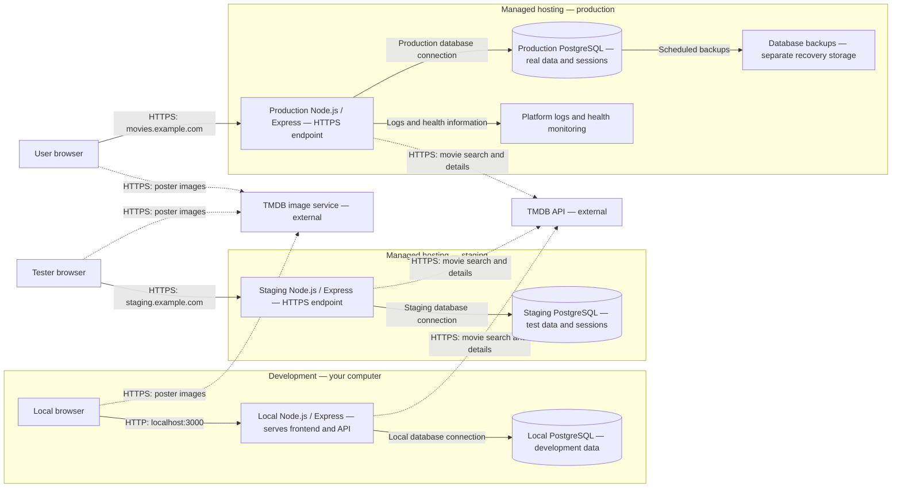

# Movie-night negotiator — deployment diagram

A deployment diagram shows where your application and database run and how those locations connect. Think of a restaurant with a practice kitchen, a rehearsal kitchen and the kitchen serving paying customers: the recipe moves between them, but each keeps its own supplies.

Status: proposed deployment design, consistent with ROADMAP.md and CONTAINER_DIAGRAM.md. No infrastructure has been provisioned and no application has been deployed.

The hosting provider and real domains remain to be chosen. The example.com addresses below are illustrative, not existing project URLs. The managed host supplies the HTTPS endpoint in front of each Express process; the platform's internal routing is grouped into the web-service box.

## 1. Where the application runs

Solid arrows identify application/infrastructure connections; dotted arrows identify calls to external TMDB services. They do not show code promotion. Backups and monitoring are required operational capabilities, not necessarily separate custom services.

All three Express instances serve both frontend files and API routes. After loading those files, frontend JavaScript runs in the corresponding browser. There is no separate frontend hosting service in this first-release design.

## 2. How a release moves through environments

```mermaid
flowchart LR
    work["Local development: feature branch"]
    review["GitHub pull request: checks and review"]
    candidate["Merge to main: candidate commit SHA"]
    ci["GitHub Actions: test exact candidate SHA"]
    testDb[("Temporary CI PostgreSQL")]
    stageRelease["Staging deploy job: migrations and deploy"]
    stageChecks["Staging checks: health and browser walkthrough"]
    promote["Manual promotion: select tested SHA"]
    prodRelease["Production deploy job: migrations and same SHA"]
    prodChecks["Production health and smoke checks"]

    work -->|"Push changes"| review
    review -->|"Checks pass and review complete"| candidate
    candidate -->|"Test merged commit"| ci
    ci -->|"Integration tests"| testDb
    ci -->|"All checks pass"| stageRelease
    stageRelease -->|"Deploy succeeds"| stageChecks
    stageChecks -->|"Checks pass"| promote
    promote -->|"Approved release"| prodRelease
    prodRelease -->|"Verify live behavior"| prodChecks
```

GitHub Actions runs the checks and deployment jobs. The pipeline boxes represent workflow stages, not new application servers. A failed stage stops promotion. The CI database is temporary test infrastructure, separate from the three environment databases. GitHub documents this setup using a PostgreSQL service container. [CI database documentation](https://docs.github.com/en/actions/tutorials/use-containerized-services/create-postgresql-service-containers)

Production receives the exact commit verified on staging. A candidate might be called SHA a1b2c3d in your release record; this is only an example identifier, not a real commit from this project.

If your chosen host rebuilds from Git instead of promoting a prebuilt artifact, pin the same commit, Node version and dependency lockfile. Prefer reusing a tested artifact where supported. Record the deployed SHA and migrations.

## Environment separation

| Item | Development | Staging | Production |
|---|---|---|---|
| Purpose | Build and debug | Rehearse releases | Serve real users |
| App runtime | Local Node/Express | Managed web service | Separate managed web service |
| Data | Invented local data | Invented test data | Real accounts, nights and votes |
| Database | Local database | Separate staging instance | Separate production instance |
| Access | Developer | Testers, with a test-access restriction to choose | Intended users |
| APP_ENV | development | staging | production |
| NODE_ENV | development | production | production |
| App address | localhost:3000 | Illustrative staging.example.com | Illustrative movies.example.com |

Staging uses production runtime behavior while connecting to staging resources. Keep the application/database versions aligned with production closely enough to make staging tests meaningful. [Express production settings](https://expressjs.com/en/advanced/best-practice-performance/)

Each app instance has its own DATABASE_URL and SESSION_SECRET. Database users are scoped to that environment; users/sessions never cross between staging and production. Keep database access private where supported, or restrict it to the application and authorized maintenance access with the provider's required secure connections.

Keep TMDB tokens server-side and configure them per environment. Use separate credentials where the TMDB account supports them; otherwise sharing an external API credential does not justify sharing your app databases or session secrets.

Local secrets live in an ignored local environment file. Hosted app secrets live in the hosting platform's settings; deployment credentials live in the appropriate GitHub Actions environment. Commit only variable names/placeholders in an example configuration, never real secret values.

## Release controls

- Pull-request CI uses temporary data and mocked TMDB responses for reliable automated tests. It does not need production credentials.
- Test the final candidate on main; a passing PR alone is insufficient if the merge changes the commit being released.
- Restrict deployments to trusted workflows and serialize deployments within each environment to prevent overlapping releases.
- Run migrations through an authorized release job with access to that environment. Do not assume a GitHub-hosted runner can directly reach a private database; a hosting-side release job may be needed.
- Rehearse migrations and the two-user nomination/voting journey on staging. Promote only after those checks pass.
- Use a manual production promotion step. GitHub environment protection/approval features depend on account plan and repository visibility; if unavailable, use an explicitly triggered workflow restricted to maintainers. [Deployment environment documentation](https://docs.github.com/en/actions/concepts/workflows-and-actions/deployment-environments)
- Prevent a hosting-side automatic deploy from bypassing your chosen pipeline.
- Verify production health after deploy and keep a record of the commit, migration state and deployment outcome.

The ordinary app database account should have only the permissions it needs. A migration job can use separate credentials with schema-change permission.

## Backups and recovery

Choose the production backup mechanism, retention and recovery targets with the hosting provider. Rehearse restoring into an isolated database; a backup you have never restored has not demonstrated that recovery works.

Keep an application rollback target: the previous working commit/artifact. An app rollback is safe only while that version remains compatible with the migrated schema. Favor backward-compatible changes and plan a forward repair or coordinated database recovery for incompatible changes. Restoring a backup can lose data written after that backup; it is not a routine first step for every failed deploy.

The diagram groups health monitoring and logs under platform operations. Choose the health endpoint, failure alert destination and the log fields you need; keep passwords, session cookies and API tokens out of logs.

## Minimal walkthrough

You add a board feature locally, open a pull request, merge after checks/review, then test the exact resulting commit. That commit is deployed to staging with its staging migration. You verify the feature and manually promote the same commit to production. Production applies the appropriate migration to its own database and serves the feature with production secrets.

No staging account or movie-night record is copied to production by this release.

## Hands-on check

On paper, point to the database used when a tester casts a staging vote. It must be staging PostgreSQL.

Once the app exists, create a test night on staging and verify it is absent from production. Also compare the recorded deployed commit IDs after promotion: they should match.

## Common misconception

Development, staging and production are environments, not necessarily three Git branches. In this plan, branches organize changes while a tested commit moves through separate runtime environments. Deploying code does not mean copying databases or secrets.

