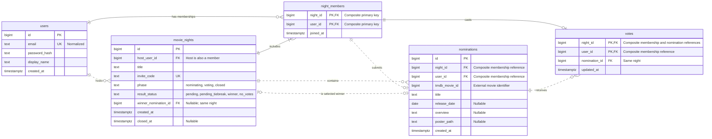

# Movie-night negotiator — Entity Relationship Diagram

An ERD shows the records your database keeps and how they relate to one another. Think of linked guest lists, suggestion cards and ballots: each card or ballot points to the right guest and gathering.

Status: proposed PostgreSQL model for the existing roadmap and state diagram. This is a design document, not SQL migrations or application code.

## Diagram



## Reading the diagram

- **PK:** primary key, identifying one row. In night_members and votes, the two PK fields form one combined key; neither field is individually unique.
- **FK:** foreign key, linking a row to an existing row. Some FK marks participate in a combined relationship rather than separate single-column references.
- **UK:** unique key, such as the email or invite code.
- **Exactly one:** `||`; **zero or one:** `o|`; **zero or many:** `o{`; **one or many:** `|{`.
- Solid relationships identify a child through its parent's key; dotted relationships link records whose primary keys are independent.

A user can host many nights and join many nights. Each night has one host and at least that host as a member. Membership resolves the many-to-many relationship between users and nights.

Each membership can have zero or one nomination and zero or one vote. A nomination can receive many votes. A night can have zero or one winner; an individual nomination can win only its own night.

The winner line and the contains line represent different relationships between the same two tables: belonging to a night and being that night's selected winner.

## Compound constraints to specify

Mermaid's per-column badges do not fully express compound constraints. These are part of the proposed schema:

| Table | Constraint | Purpose |
|---|---|---|
| night_members | Primary key (night_id, user_id) | One membership per user/night. |
| nominations | Unique (night_id, user_id) | At most one nomination per member/night. |
| nominations | Unique (night_id, tmdb_movie_id) | Reject the same movie twice within a night. |
| nominations | Foreign key (night_id, user_id) → night_members (night_id, user_id) | Nominator is a member of that exact night. |
| nominations | Unique (night_id, id) | Referenced key for same-night votes and winners. |
| votes | Primary key (night_id, user_id) | One current vote per member/night; changing it updates that row. |
| votes | Foreign key (night_id, user_id) → night_members (night_id, user_id) | Voter is a member of that exact night. |
| votes | Foreign key (night_id, nomination_id) → nominations (night_id, id) | Vote targets a nomination from the same night. |
| movie_nights | Foreign key host_user_id → users.id | Host account exists. |
| movie_nights | Foreign key (id, host_user_id) → night_members (night_id, user_id) | Host is a member of their own night. |
| movie_nights | Foreign key (id, winner_nomination_id) → nominations (night_id, id) | Saved winner belongs to this night. |

night_members.night_id references movie_nights.id; night_members.user_id references users.id. nominations.night_id references movie_nights.id.

The host-membership constraint forms a creation dependency: the night and its initial membership must be created together. Plan to defer that foreign-key check until the transaction ends; the referenced membership key stays nondeferrable. This is an implementation detail to settle when writing migrations.

Require identity/reference fields except winner_nomination_id, which remains null until there is a winner. Require title, email, password_hash, invite_code, phase/result status and timestamps other than closed_at. Optional movie metadata is marked nullable in the diagram.

The unique (night_id, id) pair is intentionally explicit even though id itself is unique: the pair supplies the referenced key for the compound same-night foreign keys. [PostgreSQL constraint documentation](https://www.postgresql.org/docs/current/ddl-constraints.html)

## What the tables own

- **users:** your app's accounts. Host is a role within a particular night, not a separate type of account.
- **movie_nights:** title, invitation, lifecycle and final outcome.
- **night_members:** who belongs to each night.
- **nominations:** who suggested which TMDB movie; saved metadata for rendering the board.
- **votes:** each member's current selection.

tmdb_movie_id is an external identifier, not a foreign key into a local movies table. This small app stores a metadata snapshot with each nomination. A shared movies table can be considered later if keeping movie metadata synchronized becomes a requirement.

Authentication sessions still live in PostgreSQL as established in the architecture. Their infrastructure table is omitted from this domain ERD because its fields are supplied by the selected session-store library; document that table when selecting the store.

## Rules outside ordinary relationships

The ERD does not enforce all behavior. Server authorization and coordinated database transactions must also enforce:

- Joining/nominating only during Nominating; voting only during Voting.
- Only the host starts/closes voting and resolves a tie.
- At least one nomination before opening voting.
- No accepted vote omitted by a concurrent close request.
- Winner selected from the unique highest-voted movie or, after a tie, from the frozen tied leaders.
- Finalized results cannot be changed.

Also define allowed phase/result_status combinations and winner/closed_at nullability in the schema specification, consistent with STATE_DIAGRAM.md. Do not persist a manually incremented vote total in this initial design; derive totals from votes.

Deletion/retention rules remain a product decision. Before implementation, choose how account removal, membership removal and deleting a night affect saved history; do not silently cascade those records away.

## Minimal data example

```text
users:         id=7, display_name=Sam
movie_nights:  id=12, host_user_id=7, phase=voting
night_members: night_id=12, user_id=7
nominations:   id=31, night_id=12, user_id=7, tmdb_movie_id=348, title=Alien
votes:         night_id=12, user_id=7, nomination_id=31
```

Sam hosts night 12, belongs to it, nominates Alien and votes for it. The schema allows self-voting, as proposed in the roadmap.

## Hands-on check

On paper, add a second nomination for (night_id=12, user_id=7): the nomination uniqueness rule rejects it. Then point Sam's vote at a nomination belonging to night 13: the compound nomination reference rejects it.

Adding a nomination for Sam in a different night is allowed when Sam is a member there. The limit is per night, not per account.

## Common misconception

Drawing a line between tables does not create enforcement. Migrations must implement the keys and constraints, and the application must implement permissions and lifecycle checks.

