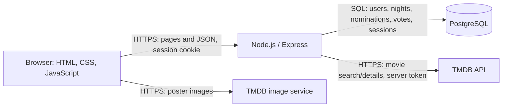

# Before coding: movie-night negotiator

Preparation means agreeing on what the app should do and how its parts will cooperate before implementing a feature. Think of planning a gathering: agree on the guest list, voting rules and seating before setting everything up.

This is a working checklist, not a completed specification. The examples below are starting points; choose and document your rules yourself. Keep each document short and update it when a decision changes. Retain HTML/CSS/JavaScript, Node.js/Express and PostgreSQL.

## 1. Product brief and scope

Create `docs/01-product-brief.md` with:

- Problem: friends struggle to agree on a movie.
- Audience and roles: host and invited participants; the host also participates.
- Core journey: create/join a night → nominate → vote → see a result.
- First-release features and exclusions. Defer chat, streaming integrations and personalized recommendations.
- Success measure: for example, a group of five completes a night without assistance.
- Practical constraints: your available time, hosting budget, supported devices and TMDB usage requirements.

Speak to two or three potential users. Ask how they currently choose movies and what causes disagreement. Record what you learn rather than assuming every extra feature is useful.

## 2. Business rules, permissions and acceptance criteria

Create `docs/02-rules.md`. Resolve these questions before drawing the database:

- Who creates a night, joins, sees the board and advances its phase?
- When can participants join or leave? Does voting freeze membership?
- Can users replace or withdraw a nomination before voting? What happens to duplicate movies?
- Is there one vote per person? Can they change it or vote for themselves?
- Are vote totals visible while voting, or revealed only at closing?
- What happens with ties, no votes, no nominations or an absent host?
- Is closing manual or deadline-based? Can a closed night reopen?

Use a permissions table with actions as rows and visitor, nonmember, member and host as columns. Make restrictions depend on the phase as well as the role.

Write a short user story and observable acceptance criteria for each feature. Example:

> As a member, I want to nominate one movie so that my choice appears on the shared board.
>
> Given I already nominated a movie for this night, when I submit another nomination, then the app rejects it and the original remains. Two simultaneous submissions must also leave at most one nomination.

Important clarification to the earlier roadmap: if the host chooses among tied leaders after voting closes, votes and nominations stay frozen, but the result may move from `pending_tiebreak` to `winner`. “Closed” does not mean the winner already exists. Record this distinction explicitly.

## 3. User flows and wireframes

Create `docs/03-user-experience.md` with a user-flow diagram and rough screen sketches.

Use [USER_FLOW.md](USER_FLOW.md) as the proposed flow to review before sketching the screens.

- Flow: sign in → create/join night → search → nominate → vote → result.
- Screens: registration/login, nights list, create/join, board with search, result.
- For each screen, sketch loading, empty, error and success states. Include expired sessions, duplicate nominations, missing posters and a tie awaiting selection.
- Plan readable contrast, keyboard access, form labels, mobile layout and visible feedback after actions.

Example board wireframe:

```text
Friday movie night                 Phase: Voting
You nominated: Alien               Your vote: Arrival

[Alien · 1979 · poster]             [Arrival · 2016 · poster]
[Vote]                             [Selected]

Host controls: [Close voting]
```

Walk through the sketches with a friend before polishing colors.

## 4. Architecture and external integration

Create `docs/04-architecture.md` with two small architecture diagrams:

The initial [system-context diagram](SYSTEM_CONTEXT.md) and [container diagram](CONTAINER_DIAGRAM.md) are available for review.

1. **System context:** people, your app and TMDB. It shows the app's surroundings.
2. **Container diagram:** browser, Express server and PostgreSQL, with labeled connections. Here “container” means a major running part, not necessarily Docker.

Starter container view:



Record responsibilities: the browser renders and collects input; Express authenticates, checks permissions and coordinates operations; PostgreSQL enforces data relationships and uniqueness. TMDB supplies movie information, not your app's voting or login system.

Check TMDB's search/details responses, image URL construction, missing data, pagination, errors and attribution. Plan server timeouts and safe retry behavior. Store your token only on the server. [TMDB authentication](https://developer.themoviedb.org/docs/authentication-application) and [attribution](https://developer.themoviedb.org/docs/faq).

Keep architecture decisions in short records: decision, reason, alternative considered and tradeoff. Examples: cookie sessions, plain SQL, manual refresh and host-controlled closing.

The C4 guidance says context and container diagrams are sufficient for most teams; add more detail when it answers a specific question. [C4 diagrams](https://c4model.com/diagrams)

## 5. Lifecycle and critical interactions

Create `docs/05-behavior.md` with a state diagram and two sequence diagrams.

Use [STATE_DIAGRAM.md](STATE_DIAGRAM.md) as the proposed lifecycle, including the result states after voting closes. The proposed [sequence diagrams](SEQUENCE_DIAGRAMS.md) cover nomination submission, voting/closing and a close-vote race.

**State diagram:** shows allowed phases and transitions, like the positions on a switch.

```mermaid
stateDiagram-v2
    [*] --> Nominating
    Nominating --> Voting: Host starts voting; at least one nomination
    Voting --> Closed: Host closes; freeze votes
    Closed --> [*]
```



Annotate who triggers each transition, its conditions and permitted actions. Inside the closed phase, distinguish winner, no votes and pending tiebreak if using those rules.

**Sequence diagrams:** show who talks to whom over time, like following a receipt through a restaurant. Draw only the interactions with important failure cases:

- Nomination: browser → Express → TMDB → PostgreSQL → browser. Include membership/phase validation, duplicate rejection and a phase change while TMDB is responding.
- Voting/closing: browser → Express → PostgreSQL → browser. Include a vote racing with closure, duplicate requests, tie selection and a repeated close request.

Write the intended outcome before choosing transaction details: every accepted vote is included, votes cannot change after closing, and repeating close cannot change a completed result. The final database check must occur during the coordinated write, not only before an external API call.

## 6. Database ERD and schema specification

Create `docs/06-data-model.md` with:

The proposed [Entity Relationship Diagram](ERD.md) includes the core tables and compound constraints for review.

- An **ERD**: a map of entities and their relationships, like linked sheets in a filing system.
- A **schema specification**: each table's columns, types, required fields, keys, constraints, defaults and deletion rules.

An ERD explains connections; the schema supplies the precise rules needed to implement them. SQL migrations come later.

| Table | Candidate fields | Rules to specify |
|---|---|---|
| users | id, email, password_hash, display_name, created_at | Unique normalized email; never plaintext passwords. |
| movie_nights | id, host_user_id, title, invite_code, phase, closed_at, result_status, winner_nomination_id | Unique invite code; allowed phases; nullable winner for unresolved/no-vote results. |
| night_members | night_id, user_id, joined_at | One membership per user/night; host must participate. |
| nominations | id, night_id, user_id, tmdb_movie_id, title, release_date, overview, poster_path | One nomination per user/night; duplicate movie rule; nominator belongs to this night. |
| votes | night_id, user_id, nomination_id, updated_at | One vote per user/night; voter is a member; nomination belongs to the same night. |
| sessions | session-store-defined fields | Follow the selected session store; define expiry/cleanup. |

These are candidate fields, not a finalized database design. In the ERD, mark one-to-many relationships: user → memberships, night → memberships, night → nominations and nomination → votes. Each membership has zero or one nomination and zero or one vote. Add the host and winner links.

Specify compound uniqueness and foreign keys where appropriate so a vote cannot point to another night's movie. Ensure a stored winner also belongs to its night. Document which rules require server authorization/transactions instead of ordinary constraints. [PostgreSQL constraints](https://www.postgresql.org/docs/current/ddl-constraints.html)

Test the model with invented rows:

```text
night_members: night_id=12, user_id=7
nominations:   id=31, night_id=12, user_id=7, tmdb_movie_id=348
votes:         night_id=12, user_id=7, nomination_id=31
```

Try replacing the vote's nomination with one from night 13. Your design must explain how that is rejected. Also decide what account/night deletion means for historical results and privacy.

## 7. API contract and data schemas

Create `docs/07-api-contract.md`. An API contract is the agreed shape of requests and replies, like an order form both sides understand.

List the routes for registration/login/logout, current user, create/join/read night, movie search, nomination, cast/change vote, phase changes and tie selection. For each route define:

- HTTP method and path; authentication, membership and phase requirements.
- Request fields, types, required fields and validation limits.
- Success status/body and failure statuses with stable error identifiers.
- Retry behavior and whether repeated requests have the same effect.

Illustrative contract, not application code:

```text
POST /api/nights/12/nominations
Content-Type: application/json
Cookie: session=<opaque value>
CSRF protection: required

Body: {"tmdbMovieId":348}
Success: 201, saved nomination
Conflict: 409, {"error":{"code":"ALREADY_NOMINATED"}}
```

The user identity comes from the session, not a client-submitted user ID. Fetch trusted movie details server-side rather than accepting arbitrary titles/posters from the browser.

Start with a readable route table; capture it in OpenAPI as the contract stabilizes. OpenAPI describes APIs using JSON or YAML, including request/response schemas. [OpenAPI introduction](https://www.openapis.org/what-is-openapi)

## 8. Security, quality and delivery plan

Create `docs/08-quality-and-delivery.md`.

The proposed [deployment diagram and release pipeline](DEPLOYMENT_DIAGRAM.md) show environment separation and commit promotion.

- **Security:** identify what must be protected, who could misuse it and the protections. Example: a member changes the URL to another night → require server-side membership checks. Cover password/session handling, CSRF, SQL injection, untrusted movie text, invite guessing, rate limits, secrets and sensitive log data. [OWASP threat modeling](https://cheatsheetseries.owasp.org/cheatsheets/Threat_Modeling_Cheat_Sheet.html)
- **Quality targets:** choose a realistic group size and response target, supported browsers and accessibility expectations. Define user feedback when TMDB is slow or unavailable.
- **Test plan:** acceptance tests mapped to rules; database integration tests for constraints/concurrency; a browser test covering two users through a night. Include tied results, zero votes and expired login.
- **Deployment diagram:** show local development and separate staging/production instances, databases and secrets; connect GitHub Actions to deployments. Draw the same tested commit moving from staging to production.
- **Operations:** define migration/release checks, health checks, useful logs, backup/restore rehearsal and recovery when an application rollback cannot reverse a database change.
- **Backlog:** order small features by dependency. Each task has a completion check. Definition of done: behavior meets criteria, relevant tests pass, review complete and documentation updated.

## Ready-to-code checklist

- [ ] Scope, roles and disputed rules are written down.
- [ ] A three-person walkthrough succeeds, including a tie and a failure.
- [ ] Flows and wireframes show normal and error states.
- [ ] Architecture and lifecycle diagrams agree with the rules.
- [ ] ERD/schema explain membership, nomination/vote limits and same-night relationships.
- [ ] The first feature's API contract and acceptance criteria are clear.
- [ ] Security, tests and environment separation have an initial plan.
- [ ] The first implementation task is small enough to complete and verify.

You do not need every future feature fully specified. Begin with the agreed architecture and the next feature designed well enough to implement; review documents as you learn.

## First hands-on task and common misconception

Today, write the one-page product brief and walk through one night with three named people. Record every question that stops the walkthrough, then settle the rules before designing tables.

A professional project is not measured by the number of diagrams. Its documents should expose decisions, prevent contradictory behavior and give you a way to verify what you build.
