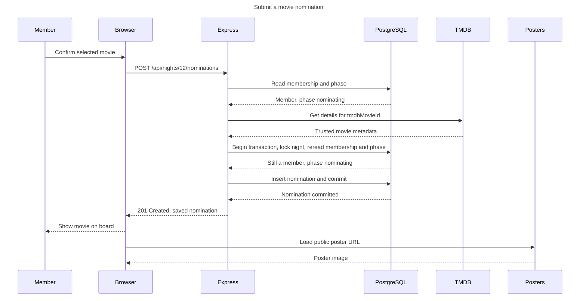
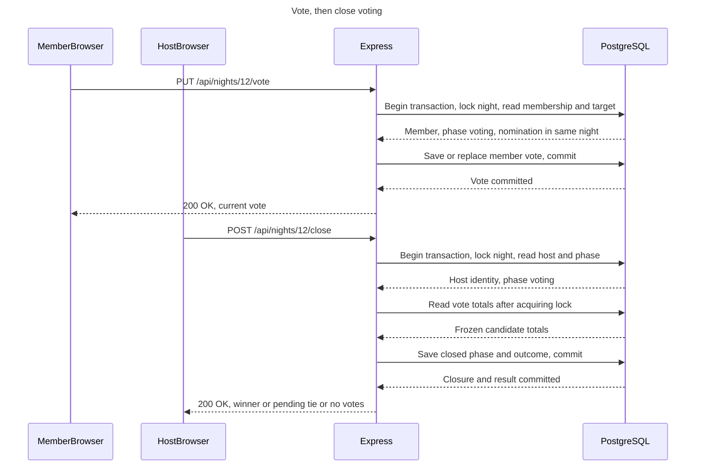
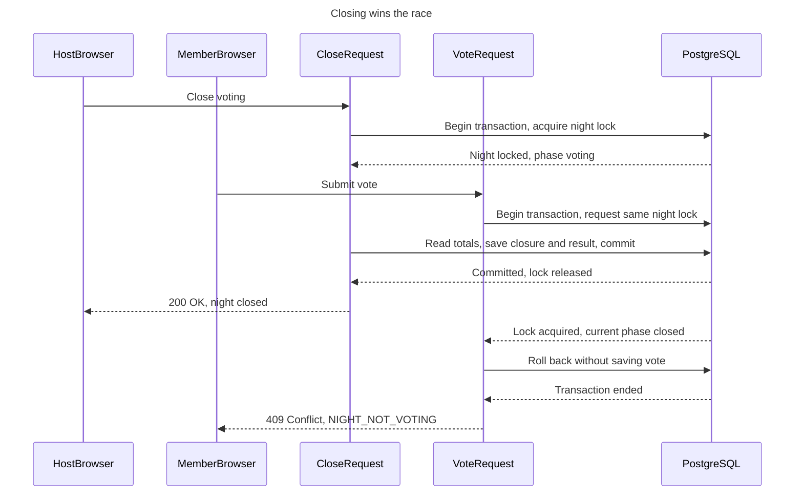

# Movie-night negotiator — sequence diagrams

A sequence diagram shows the order of messages exchanged to complete one action. Think of tracking an order slip from a restaurant customer to the counter, kitchen and records room, then back with a confirmation.

Status: proposed interactions for the existing architecture, ERD and lifecycle. These diagrams specify behavior, not application code. Endpoint names, bodies and error identifiers below are draft API contracts to review later.

Read each diagram from top to bottom. Solid arrows are requests/actions; dashed arrows are replies. Participants are the people, browser, application or external services involved.

## 1. Submit a movie nomination

Preconditions: the user has signed in, joined the night and selected a TMDB search result. Search itself follows Browser → Express → TMDB → Express → Browser. Express handles its TMDB credential; the browser never receives it.

The example request body is `{"tmdbMovieId":348}`. User identity comes from the session, and trusted metadata comes from TMDB.

Before the depicted operations, Express validates the session, input and CSRF protection. Its initial membership/phase check avoids unnecessary external requests. Its final check happens after locking the night because voting might start while TMDB is responding. Keep network calls outside the database transaction.

Posters denotes TMDB's external image service, not an extra application component. A missing poster uses a placeholder without undoing a successfully saved nomination.

### Alternative outcomes

| Condition | Response/behavior | Saved changes |
|---|---|---|
| Invalid/expired session | 401; return to sign-in. | None. |
| Invalid body or CSRF protection | Reject the request before saving; show feedback. | None. |
| Nonmember | 403; deny access. | None. |
| Night missing | 404; show unavailable night. | None. |
| Already nominated or movie already present | 409; explain conflict and preserve existing nomination. | None. |
| TMDB unavailable or invalid movie ID | Show retry or choose-another-movie feedback; do not insert untrusted data. | None. |
| Night becomes Voting before final check | Roll back; 409; refresh the current board. | None. |
| Database write/commit fails | End/roll back the transaction; report failure rather than showing success. | No confirmed nomination. |

Uniqueness and membership constraints from ERD.md remain the final database checks. Concurrent duplicate requests can produce only one saved nomination.

## 2. Vote, then close voting

This diagram shows the successful order: a vote commits first, then the host closes. A changed vote replaces the same member/night row rather than adding another vote.

Vote body example: `{"nominationId":31}`. The database returns the relevant records, and Express checks membership, phase, host identity and the target relationship before writing. Grouped database messages summarize several operations, not single SQL statements.

Closing computes one of the STATE_DIAGRAM.md outcomes:

| Frozen totals | Saved result |
|---|---|
| No votes | phase=closed, result_status=no_votes, no winner. |
| One movie has the highest total | phase=closed, result_status=winner, selected nomination. |
| Highest total is tied and votes exist | phase=closed, result_status=pending_tiebreak, no winner yet. |

Participants use manual refresh: Browser → Express → PostgreSQL → Express → Browser to load the current board/result. The close request does not push results automatically to other browsers.

For a pending tie, the host sends a proposed `POST /api/nights/12/tiebreak` with a nomination ID. Express locks the night, rechecks host identity and pending result, verifies the choice is among the frozen leaders, saves the winner and commits before acknowledging success. This does not reopen voting.

### Alternative outcomes

- Invalid session or nonmember: reject before changing a vote.
- Nomination from another night: reject the target; the compound foreign key also protects the relationship.
- Voting not open: 409; refresh board/result.
- Nonhost tries to close or resolve a tie: 403; no change.
- A repeated close of an already closed night returns its recorded outcome; it never recomputes or replaces a finalized result.
- Repeating the already successful tiebreak with the same nomination returns the saved result; choosing a different winner afterward is rejected.
- A failed commit never produces a success confirmation. If the commit succeeded but the connection failed before confirmation, retry/read-back must reveal the saved result without duplicating or changing it.

## 3. Concurrency detail: a vote arrives while closing

CloseRequest and VoteRequest are two request handlers inside the same Express application, shown separately to explain overlap. They are not separate services.

This example assumes the close transaction obtains the night lock first. If the vote obtains it first and commits successfully, closing waits and includes that vote in its totals. Request arrival time alone does not determine the outcome.

The proposed implementation uses a common per-night row-lock convention with PostgreSQL Read Committed transactions:

1. Begin the transaction and obtain the night-row lock in a separate operation.
2. Read/recheck the phase and permissions after obtaining it.
3. Perform the related write/count and commit before releasing the lock.
4. All relevant mutations follow this convention, including joining, nomination writes, starting voting, votes, closing and tie selection.

Locking the night does not automatically lock all vote rows. The ordering works because every relevant request explicitly takes the same night lock first. Vote counting happens in a statement after the lock is acquired so it sees preceding committed votes. [PostgreSQL row locking](https://www.postgresql.org/docs/18/explicit-locking.html) and [Read Committed isolation](https://www.postgresql.org/docs/18/transaction-iso.html).

## Minimal walkthrough

Sam nominates Alien in night 12, then votes for nomination 31. The vote commits, Alex closes voting and Alien has the unique highest total. The saved result becomes `phase=closed, result_status=winner, winner_nomination_id=31`.

## Hands-on check

Trace Sam's nomination on paper, then move the host's “start voting” action between TMDB's response and the nomination's final phase check. The nomination must be rejected.

Next, trace both orderings of the close/vote race. Record which vote is saved and which total the final result should contain. Once implemented, inspect the request bodies/statuses in DevTools → Network and test overlapping requests using two signed-in browser sessions.

## Common misconception

Checking the phase once at the start of a request is not enough: another request can change it before the write. Nor does sending a request guarantee it was saved; acknowledge success only after the commit succeeds.

