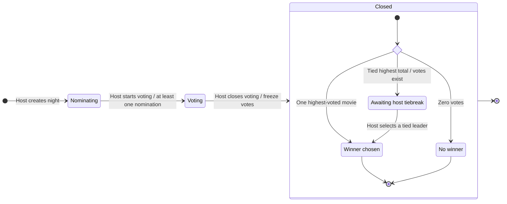

# Movie-night negotiator — state diagram

A state diagram shows the stages one movie night can occupy and the events that move it between stages. Think of a ballot box: suggestions arrive first, voting opens, then ballots are sealed and the outcome is decided.

Status: proposed first-release lifecycle, consistent with USER_FLOW.md. Host-controlled phases, one changeable vote per member and host resolution of ties remain the roadmap's suggested defaults.

## Diagram

The diamond is a decision, not a lasting state. When the host closes voting, classify the frozen result: zero votes first, otherwise a unique leader or tied leaders. Creating a night and opening/closing voting are events; Nominating, Voting and Closed are states.

## Allowed actions

| State | Allowed | Blocked |
|---|---|---|
| Nominating | Join with a valid invite; view board; nominate at most one movie per member. Host can start voting once at least one nomination exists. | Voting; starting voting with an empty board. |
| Voting | View board; cast or change one vote per member; abstain. Host can close voting. | Joining; adding or editing nominations. |
| Closed / Awaiting host tiebreak | View frozen totals and tied leaders. Host can choose one of those leaders. | Joining, nominations, voting and reopening. |
| Closed / Winner chosen | View final winner and totals. | Participation changes; changing the finalized winner; reopening. |
| Closed / No winner | View that no votes were cast. | Participation changes; arbitrarily selecting a winner; reopening. |

The host also participates under the same nomination and voting limits. The current user-flow draft has no nomination replacement/withdrawal action.

A failed or unauthorized action leaves the state unchanged. A TMDB failure or expired user login does not change the movie night's lifecycle. A movie night with no nominations stays Nominating because opening voting is blocked.

## Mapping to saved data

Keep the distinction between phase and result status explicit:

| Diagram state | phase | result_status | Winner |
|---|---|---|---|
| Nominating | nominating | pending | None |
| Voting | voting | pending | None |
| Awaiting host tiebreak | closed | pending_tiebreak | None |
| Winner chosen | closed | winner | Selected nomination |
| No winner | closed | no_votes | None |

Illustrative stored state: `phase=closed, result_status=pending_tiebreak, winner_nomination_id=null`.

These are design values, not SQL or application implementation. Result classification happens as part of closing against a consistent set of frozen votes; the decision diamond does not require an extra persistent database status.

The end markers mean that the lifecycle is complete. They do not mean that the database record disappears; members can still view a completed night.

## Transition checks

- Only the host advances phases or resolves a tie.
- Starting voting freezes membership and nominations.
- Closing and vote submission must be coordinated so an accepted vote is counted and later votes are rejected.
- Tie selection uses the frozen leaders; votes stay closed throughout selection.
- Once finalized, repeating a close/tiebreak request must not alter the recorded result.
- There is no cancellation, deadline, automatic tiebreak or reopening in this proposed lifecycle. Add those transitions only after choosing their rules.

## Minimal walkthrough

Alex creates a night → Nominating.
Alex starts voting after three nominations → Voting.
Alex closes with totals 2–1–0 → Closed / Winner chosen.

For totals 1–1–1, closing instead produces Closed / Awaiting host tiebreak. Alex selects one tied leader → Closed / Winner chosen.
For totals 0–0–0, the outcome is Closed / No winner, not a tie.

## Hands-on check

Trace totals 2–1–0, 1–1–1 and 0–0–0 through the diagram. Then try to cast a vote while awaiting the tiebreak: it must be rejected because the phase is already Closed.

## Common misconception

Closed voting does not always mean a winner has been decided. Votes can be frozen while the host still needs to resolve a tie. A state diagram follows the movie night's lifecycle rather than the screens a user visits.

