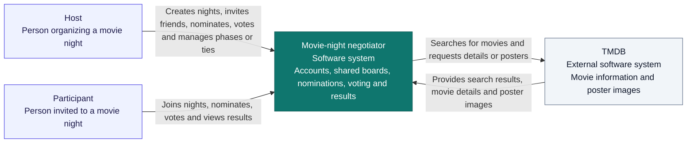

# Movie-night negotiator — system-context diagram

A system-context diagram shows who uses your application and which outside systems it depends on. Think of a neighborhood map: your app is one building, users are its visitors, and TMDB is a nearby service it uses.

## Diagram

## How to read it

- **Host and participant are roles:** the host is also a participant, with the same nomination/vote limits plus night-management actions.
- **Your app is the system being designed:** it owns app accounts, membership, nominations, votes and the chosen result.
- **TMDB is outside your system:** it supplies movie information and images. Users sign in to your app; they do not need TMDB accounts.
- **Arrows describe relationships:** they do not specify request timing, protocols or individual endpoints. The TMDB box groups its movie API and image service at this level.

The browser interface, Express server and database are parts of the single application box. Show them separately in the container diagram. Hosting and CI belong in the deployment view.

## Minimal walkthrough

Sam joins a night, searches for Alien, nominates it and votes. Sam uses the app; the app obtains movie information from TMDB and manages the nomination/vote itself.

## Hands-on check

Cover the TMDB box and trace Sam's journey again. Identify what becomes unavailable: new movie searches/details and externally loaded posters. Existing saved nominations and voting should remain usable when the app and its database are healthy. Add this expectation to the failure-handling requirements.

## Common misconception

A context diagram does not show every technical component. Its purpose is to make the application boundary, human roles and external dependencies clear.

Reference: [C4 system-context diagram](https://c4model.com/diagrams/system-context).
