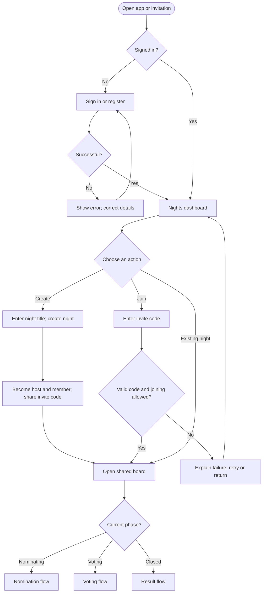
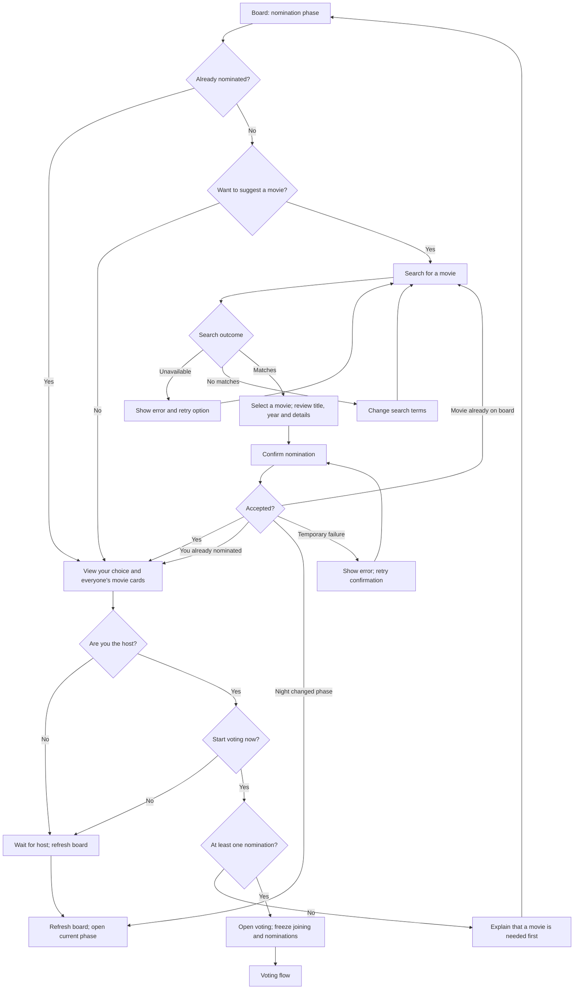
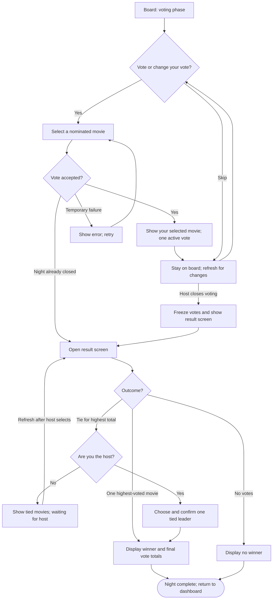

# Movie-night negotiator — user flow

A user-flow diagram maps the screens, actions and choices a person follows to complete a task. Think of it as a route map with junctions: rectangles are actions/screens, diamonds are decisions and arrows show where to go next.

Status: proposed first-release flow, using the suggested rules in ROADMAP.md and the tie clarification in PREPARATION.md. This describes the user experience; it does not choose a database or specify implementation code.

## 1. Entry and navigation

Notes:

- After authentication, preserve an invitation so the user can continue joining that night instead of retyping it.
- The existing-night list contains the user's own memberships. A direct URL to a night they do not belong to shows an access message with a route back to the dashboard.
- Joining is allowed only while nominating. If already a member, a valid invite opens the board in its current phase.
- The host is also a participant and can nominate/vote under the same limits.

## 2. Nomination flow

Movie cards show title, release year, poster and overview; use a placeholder when no poster exists. Members can skip nominating and still vote. This draft offers one confirmed nomination with no replacement/withdrawal action; that policy remains a product choice.

## 3. Voting and result flow

“Host closes voting” is available only to the host. Participants stay in voting until closure, then refresh to see the result. Self-votes are allowed, changing a vote replaces the earlier choice, and abstaining is allowed.

Closed nights accept no new members, nominations or votes. For a tied result, the host has one remaining action: resolve the tie using a tied leader. If the host does not act, the result remains pending. Closed nights do not reopen in this draft.

## Assumptions and decisions still to settle

| Topic | This diagram uses |
|---|---|
| Participation | Signed-in members only; host participates too. |
| Nomination limit | At most one per person per night; duplicate movies rejected. |
| Voting | One changeable vote per member; self-voting and abstention allowed. |
| Phase control | Host starts/closes voting manually; at least one movie to start. |
| Tie | Host selects from the tied highest-voted movies after votes freeze. |
| Updates | Manual refresh in the first release. |
| Still undecided | Live visibility of vote totals, nomination edits, leaving a night and absent-host handling. |

An expired session during any flow sends the user to sign in; return to the intended screen afterward and reload its current phase. Preserve an unsent selection when practical, but never automatically submit it after login.

## Walkthrough to validate the diagram

1. Alex creates a night and shares its invite code with Sam and Noor.
2. All three join and each submits a different movie.
3. Alex opens voting. A late visitor cannot join, and a member cannot add a second movie.
4. Alex and Sam vote for Noor's movie; Noor votes for Sam's movie.
5. Alex closes voting. Noor's movie wins with two votes.
6. Repeat with one vote for each movie: Alex must choose one tied leader.
7. Repeat with no votes: the screen says no winner.

Hands-on check: follow each route with a finger and write down the screen and available actions at every stop. Also try an invalid invite, a failed search and a vote submitted after closing.

Common misconception: a user flow is not a diagram of API requests or database operations. It describes what people do and see; sequence and architecture diagrams describe what the software does underneath.
